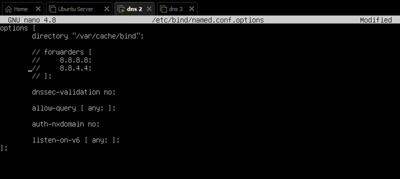

# 01. BIND9 Primary & Secondary DNS

Deployment and zone replication setup for a Primary BIND9 server (`192.168.187.50`) and two Secondary (slave) DNS servers (`192.168.187.51` and `192.168.187.52`) serving the internal `student.co.uk` zone on **Ubuntu Server**.

## Project Files

* [named.conf.local.slave](./configs/named.conf.local.slave) — Slave zone declaration pointing to Primary master `192.168.187.50` with `allow-query { localnets; };`.
* [named.conf.options.slave](./configs/named.conf.options.slave) — Global BIND9 options for secondary nodes with `dnssec-validation no;` and commented-out external `forwarders`.

## Key Objectives & Technologies

* **Slave Zone Replication:** Configured `type slave;` zones in `/etc/bind/named.conf.local` on secondary servers (`dns2` at `.51` and `dns3` at `.52`) to pull zone records from `192.168.187.50`.
* **Internal DNSSEC & Forwarder Tuning:** Disabled DNSSEC validation (`dnssec-validation no;`) in `/etc/bind/named.conf.options` so unsigned internal records for `student.co.uk` resolve without upstream chain-of-trust failures.
* **Syntax Debugging:** Diagnosed and resolved `unknown option '8.8.8.8'` parser errors in `/etc/bind/named.conf.options` caused by uncommented forwarder IP addresses using `sudo named-checkconf`.
* **Manual Zone Transfer & Client Verification:** Triggered immediate zone synchronization via `sudo rndc retransfer student.co.uk` (compensating for `notify no;` on the Primary server) and verified `NS` and `A` responses from Ubuntu Desktop using `nslookup`.

## Verification & Screenshots

### Syntax Debugging with `named-checkconf`

### Secondary Server `named.conf.options` Configuration

