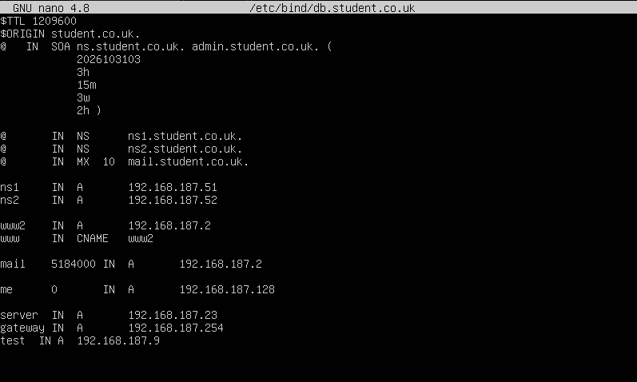
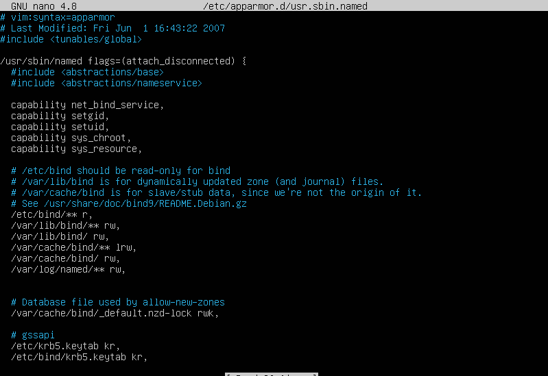
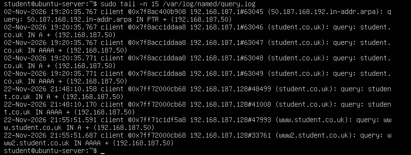

# 02. DNS Hardening, AppArmor & Query Logging

Security hardening of the BIND9 Primary DNS server (`192.168.187.50`) using a Hidden Primary topology, AppArmor Mandatory Access Control (MAC) policy updates, and dedicated DNS query logging on **Ubuntu Server**.

## Project Files

* [db.student.co.uk](./configs/db.student.co.uk) — Updated zone database (SOA serial `2026103103`) advertising only secondary name servers (`ns1` and `ns2`) to conceal the primary server.
* [named.conf.options.logging](./configs/named.conf.options.logging) — BIND9 `logging` block routing `queries` category events to `/var/log/named/query.log` with log rotation (`versions 3 size 5m`).
* [usr.sbin.named.apparmor](./configs/usr.sbin.named.apparmor) — AppArmor profile rule (`/var/log/named/** rw,`) permitting the `named` daemon to write to `/var/log/named/`.

## Key Objectives & Technologies

* **Hidden Primary Architecture:** Removed the primary server from public `NS` records in `/etc/bind/db.student.co.uk`, delegating client-facing resolution exclusively to `ns1.student.co.uk` (`192.168.187.51`) and `ns2.student.co.uk` (`192.168.187.52`).
* **Least-Privilege Log Directory Ownership:** Created `/var/log/named` (`sudo mkdir /var/log/named`) and transferred ownership to the unprivileged BIND system account via `sudo chown bind:bind /var/log/named`.
* **AppArmor MAC Confinement:** Extended `/etc/apparmor.d/usr.sbin.named` with `/var/log/named/** rw,` and reloaded enforcement policies (`sudo systemctl restart apparmor`) so `named` can write logs without disabling AppArmor.
* **DNS Query Auditing:** Enabled timestamped query logging in `/etc/bind/named.conf.options` and verified live client `A`, `AAAA`, and `PTR` query entries via `sudo cat /var/log/named/query.log`.

## Verification & Screenshots

### Hidden Primary Zone Database (`db.student.co.uk`)

### AppArmor Profile Configuration (`/etc/apparmor.d/usr.sbin.named`)

### Live DNS Query Log Verification (`/var/log/named/query.log`)

