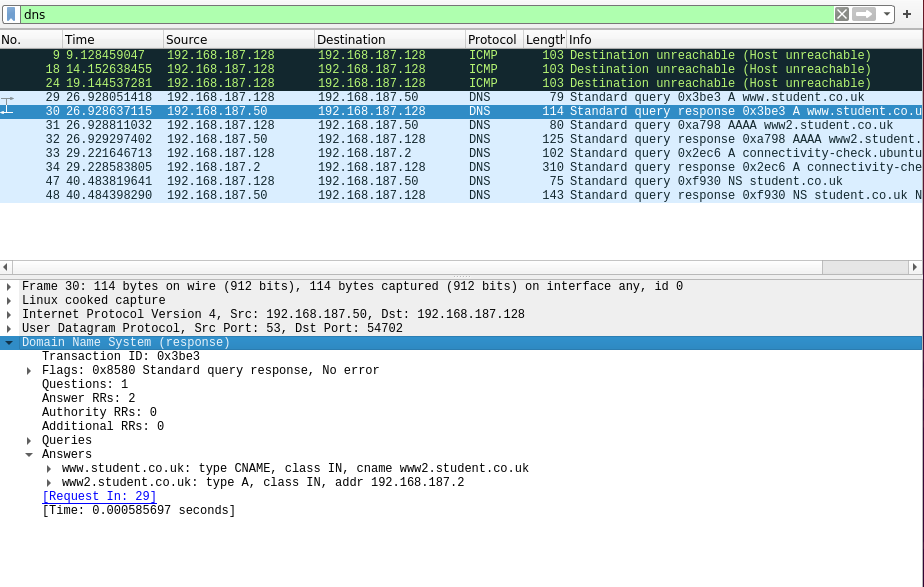
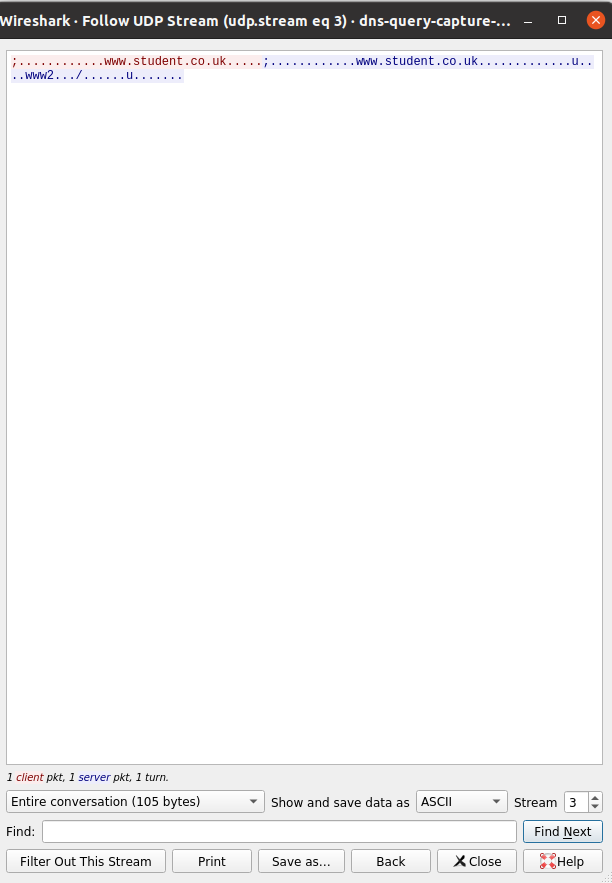

# 03. Wireshark DNS Traffic Analysis

Packet-level inspection and security auditing of DNS resolution traffic between the **Ubuntu Desktop** client and Secondary BIND9 servers (`192.168.187.51` / `192.168.187.52`) using **Wireshark**.

## Project Files

* [dns-query-capture.pcapng](./captures/dns-query-capture.pcapng) — Raw Wireshark packet capture containing `A` and `NS` DNS queries and server responses for the `student.co.uk` zone.

## Key Objectives & Technologies

* **Packet Filtering & Protocol Isolation:** Applied the `dns` display filter in Wireshark to isolate UDP port 53 name resolution traffic from background ARP, ICMP, and broadcast noise.
* **DNS Header & Answer Inspection:** Examined `Standard query` and `Standard query response` frames, verifying transaction IDs, authoritative answer flags, and resolved `A` (`www.student.co.uk` -> `192.168.187.2`) and `NS` (`ns1`, `ns2`) records.
* **Cleartext Traffic Auditing:** Inspected raw UDP streams (`Follow -> UDP Stream`) to demonstrate that standard DNS transmits queried domain names and zone topology in unencrypted plaintext, highlighting the operational need for encrypted transport protocols (DoT/DoH) on untrusted networks.

## Verification & Screenshots

### DNS Query & Response Dissection (`dns` Filter)

### Unencrypted DNS Payload Inspection (`Follow UDP Stream`)

